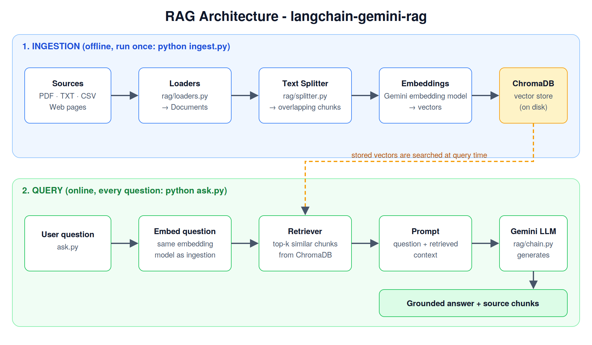
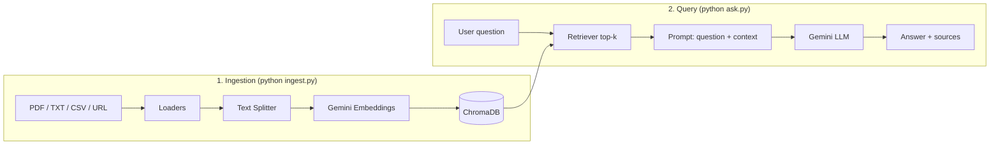

# RAG-Document-QA

A small, readable **Retrieval-Augmented Generation (RAG)** project: ask questions about your own
documents (PDF, TXT, CSV, web pages) and get answers **grounded in the source text**, with the
retrieved chunks returned as citations.

Built with **LangChain**, **Google Gemini** (embeddings + chat) and **ChromaDB**.



## How it works



| Stage | What happens | Code |
|---|---|---|
| Load | Files/URLs become LangChain `Document`s (eager or lazy) | `rag/loaders.py` |
| Split | Documents are cut into overlapping chunks | `rag/splitter.py` |
| Embed + store | Chunks are embedded in batches and saved to ChromaDB | `rag/vectorstore.py` |
| Retrieve + generate | Top-k chunks are injected into a prompt; Gemini answers from them only | `rag/chain.py` |

## Project structure

```
RAG-Document-QA/
├── README.md
├── architecture.png              # diagram shown above
├── requirements.txt
├── requirements-optional.txt     # only for the FAISS/OpenAI example
├── .env.example                  # copy to .env and add your keys
├── .gitignore
├── ingest.py                     # CLI: build the vector DB
├── ask.py                        # CLI: ask questions (one-off or interactive)
├── rag/                          # the actual pipeline
│   ├── __init__.py
│   ├── config.py
│   ├── loaders.py
│   ├── splitter.py
│   ├── vectorstore.py
│   └── chain.py
└── examples/                     # learning scripts, in order
    ├── 01_gemini_api_basics.py
    ├── 02_langchain_fundamentals.py
    ├── 03_document_loaders.py
    ├── 04_text_splitters.py
    └── 05_faiss_openai_variant.py
```

Created locally when you run it (git-ignored, never committed):
`.env` (your keys), `data/` (your documents) and `chroma_db/` (the vector database).

## Quick start

```bash
# 1. Clone and install
git clone https://github.com/<your-username>/langchain-gemini-rag.git
cd langchain-gemini-rag
python -m venv .venv && source .venv/bin/activate    # Windows: .venv\Scripts\activate
pip install -r requirements.txt

# 2. Add your API key (get one free at https://aistudio.google.com/apikey)
cp .env.example .env
#    then edit .env and set GOOGLE_API_KEY

# 3. Ingest your documents (put them in a local data/ folder - it is git-ignored)
mkdir data
python ingest.py data/your_document.pdf
#    several sources at once, including web pages:
python ingest.py data/report.pdf data/notes.txt https://en.wikipedia.org/wiki/Mahatma_Gandhi

# 4. Ask questions
python ask.py "What is the crypto regulation?"
python ask.py                       # interactive mode
```

Example output:

```
The SEC oversees traded crypto assets unless an exemption applies ...

Sources:
  [1] data/report.pdf (page 4)
  [2] data/report.pdf (page 7)
```

## Configuration

All settings are environment variables (see `.env.example`):

| Variable | Default | Purpose |
|---|---|---|
| `GOOGLE_API_KEY` | - | **Required.** Gemini API key |
| `CHAT_MODEL` | `gemini-3.8-flash` | Model that writes the answer |
| `EMBEDDING_MODEL` | `models/gemini-embedding-2` | Model that creates vectors |
| `CHUNK_SIZE` / `CHUNK_OVERLAP` | `500` / `50` | Chunking behaviour |
| `RETRIEVER_K` | `8` | Chunks retrieved per question |
| `EMBED_BATCH_SIZE` / `EMBED_SLEEP_SECONDS` | `10` / `10` | Batching to stay within free-tier rate limits |

> If a model name is rejected, check the names available to your account in Google AI Studio and set them in `.env`.

## Learning examples

The `examples/` folder walks through each concept on its own, in order:

1. `01_gemini_api_basics.py` - call Gemini (SDK) and OpenRouter (HTTP) directly
2. `02_langchain_fundamentals.py` - messages, prompt templates, output parsers, chains
3. `03_document_loaders.py` - text / PDF / CSV / web loaders, eager vs lazy loading
4. `04_text_splitters.py` - character vs recursive splitting, chunk size and overlap (runs offline)
5. `05_faiss_openai_variant.py` - same RAG idea with OpenAI + FAISS (needs `requirements-optional.txt`)

## Security notes

- API keys live in `.env`, which is git-ignored. **Never hardcode keys** in code or notebooks.
- The local vector DB (`chroma_db/`) and everything in `data/` are git-ignored, so private documents are never pushed.

## Possible next steps

- Add a Streamlit/Gradio web UI
- Add a re-ranker or MMR retrieval for better context
- Support conversation memory for follow-up questions
- Evaluate answer quality (e.g. with RAGAS)
